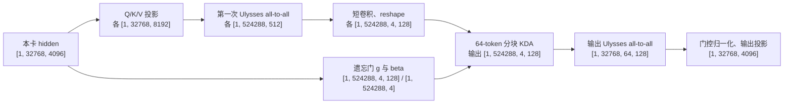

# GLM-5.3-Flash 512Ki/SP16：KDA 反向编译错误排查与修复

**结论：**首次 256 卡 profile 任务在第 1 步的 `loss.backward()` 失败。直接失败点是 TorchInductor 编译 KDA 的 Ulysses 输出交换反向时，为切片生成了超出 `int32` 范围的地址常数；KDA 状态更新内核没有报错。在 `_all_to_all_out` 上加 `@torch._dynamo.disable` 后，同配置的第二次任务完成 10/10 步，显存和时间采样均落盘。

## 排查过程与证据

1. 首次任务 `glm53-flash-512k-256gpu-profile10-1013-11155-dca25` 的 rank 0 训练日志停在初始化阶段，不能据此判断任务还在运行。检查节点 stdout 后，发现多个 rank 在首个 `loss.backward()` 编译反向图时抛出 `InductorError`，内核名为 `triton_poi_fused_add_slice_slice_backward_view_1`，报 `Scalar -4026524160 is out of range for type int32`。前面的 `failed to eagerly compile backwards ... suppressing` 只是预编译警告；后续 `loss.backward()` 的异常和 `ChildFailedError` 才确认任务失败。证据见 `work_dirs/glm53flash/02_glm53_flash_512k_256gpu_10step_profile/stdout/training_20261013_112924_0.txt` 第 7465 行附近及第 7903–7917 行。
2. 生成的 Triton 代码包含 `xnumel=268435456`、`x1=xindex//512`、掩码 `x1>=491520` 和读取地址 `-4026524160+x0+8192*x1`。这些数值与下面推导的 KDA 输出交换反向尺寸逐项吻合，因此将范围缩到该交换的 `tensor_split`/`cat` 反向，而非泛指任意 KDA kernel。
3. 用[单卡最小复现](02_glm53flash_512k_256gpu/repro_inductor_slice_backward.py)隔离“大跨度切片反向 + 编译”：512Ki、`torch.compile` 连续两次失败；256Ki、`torch.compile` 成功；512Ki、关闭编译成功。复现报错常数为 `-4026531840`，与训练报错相差末尾通道块偏移 `7680`；它确认了越界机制，单独不能确定完整模型中的调用点。GPU 运行前均用 `~/github/xtuner/zdev/gpu_lock.sh` 获取锁。
4. 对照参考仓库 `/mnt/shared-storage-user/ailab-agent-combined/delivery/codes/Xtuner-GLM5.3-Flash/integration_1009`：它同样使用 Ulysses、SP16 和编译；其提交 `490e28d6` 已在 `xtuner/v1/module/attention/kda.py:62` 的 `_all_to_all_out` 上添加相同的 `@torch._dynamo.disable`。参考日志 `/mnt/shared-storage-user/ailab-agent-combined/delivery/ckpts/exp_agent_glm53_flash/1009_512k_256u_bsz8m_mtp_tv_fp8/20261010034455/logs/rank0.log` 记录完成 4548/4548 步。参考任务能运行，因为这一交换已被隔开编译。

## KDA 计算与本次张量尺寸

本次配置 `a08exp/02_glm53flash_512k_256gpu/glm53_flash_512k_256gpu.py` 的一个 packed batch 为 `B=1`，全序列 `T=524288`，`SP=16`，每 rank 连续持有 `L=T/SP=32768` 个 token。模型隐层宽 `4096`；KDA 有 `H=64` 个 head，每个 head 的 Q/K/V 宽度 `D=128`，所以完整投影宽 `C=H×D=8192`，每 rank 交换后负责 `H/SP=4` 个 head、即 `512` 个通道。代码见 [KDA 前向](../xtuner/v1/module/attention/kda.py)的 `_forward_for_ulysses_sp`，以及 [Ulysses 交换](../xtuner/v1/ops/comm/all_to_all.py)。



第一次交换把“本卡一段序列、全部 head”改为“完整序列、4 个 head”；短卷积和 KDA 因而能在本 rank 内沿完整序列计算。遗忘门先由 `f_a_proj → f_b_proj` 投影并交换，得到对数衰减 `g`；`b_proj` 得到每 token、每 head 的 `beta`，经 sigmoid 后参与状态更新。输出交换把布局还原，供本卡的门控归一化和输出投影使用。打包文档边界由 `cu_seqlens` 传给卷积和 KDA；本实现的分块宽度固定为 64 token，见 [chunk_kda.py](../xtuner/v1/ops/kda/chunk_kda.py)。

每个 head 的状态 `S` 为 `128×128`（key 宽 × value 宽），`g_t` 是 128 维对数衰减，`beta_t` 是标量。Q/K 先做 L2 归一化；忽略批和 head 下标后，其逐 token 计算可写成：

```text
M_t = diag(exp(g_t)) S_(t-1)                 # 衰减旧状态
r_t = v_t - k_t^T M_t                        # 相对当前记忆的残差
S_t = M_t + beta_t k_t r_t^T                 # delta 更新
o_t = (q_t / sqrt(128))^T S_t                # 读取状态
```

训练时实际调用分块 KDA，而不是逐 token 循环；上式说明其数学作用。[gate 实现](../xtuner/v1/ops/kda/fused_kda_gate.py)输出 `g` 为 FP32，本模型的安全门下界设为 `-5`；打包文档之间不共享状态。

反向传播沿相反方向，关键形状如下：

| 反向节点 | 接收的梯度 | 向前一节点输出的梯度 |
| --- | --- | --- |
| 输出投影、门控归一化 | `[1, 32768, 4096]` | `[1, 32768, 64, 128]` |
| **输出 Ulysses 交换** | `[1, 32768, 64, 128]`，可视为 `[32768, 8192]` | `[1, 524288, 4, 128]`，可视为 `[524288, 512]` |
| 分块 KDA | `dO: [1, 524288, 4, 128]` | `dQ/dK/dV/dg` 各 `[1, 524288, 4, 128]`，`dβ: [1, 524288, 4]` |
| Q/K/V 前向交换及投影 | 各 `[1, 524288, 512]` | 各 `[1, 32768, 8192]`，再归约到 hidden |

## 报错中的尺寸如何对应

[通信实现](../xtuner/v1/ops/comm/all_to_all.py)在 collective 后，对序列维做 `torch.tensor_split(..., 16)`，再沿 head 维 `torch.cat`。输出交换的反向需要把 `[32768, 8192]` 梯度中的 16 个 512 通道块放回 `[524288, 512]` 的 16 个序列块。对最后一个块，令 `x1` 是目标的全局 token 行号、`x0∈[0,511]` 是块内通道，源张量的**元素偏移**为：

```text
(x1 - 15×32768)×8192 + (15×512 + x0)
= (x1 - 491520)×8192 + 7680 + x0
= -4026524160 + 8192×x1 + x0
```

| Triton 字段 | 该交换中的含义 |
| --- | --- |
| `xnumel=268435456` | `524288×512`，目标梯度元素数；源 `[32768,8192]` 也恰好这么大 |
| `x1=xindex//512`, `x0=xindex%512` | 目标的 token 行号和 512 通道块内位置 |
| `x1>=491520` | 最后一个序列块，起点 `15×32768` |
| `7680` | 源行的最后一个通道块起点，`15×512` |
| `8192` | 源梯度 `[32768,8192]` 的行跨度 |
| `-4026524160` | `-491520×8192+7680`，小于 `int32` 最小值 `-2147483648` |

有效行 `x1>=491520` 时，合成后的最终读取偏移落在源张量范围内；Triton 在执行掩码读取前，就因表达式里的**中间负常数**无法表示为 `int32` 而编译失败。公式中的 `15` 是第 16 个切分块的编号，与 stdout 里显示异常的 `rank5` 无关。这也解释了为何错误名含 `slice_backward`：失败在输出重排的反向切片，并非 KDA 状态更新的前向或反向内核。

## 修复与验证范围

当前[修复代码](../xtuner/v1/module/attention/kda.py)只在 `_all_to_all_out` 上加 `@torch._dynamo.disable`，让这一小段输出重排退出 Dynamo 编译区；collective 和 autograd 仍执行。相应的[双卡 SP 回归测试](../tests/model/test_glm53_kda.py)将 compiled 路径设为训练实际允许的 `fullgraph=False`，验证 eager/compiled、FP32/BF16 和两种 packed 布局下的输出与梯度。该测试已通过；它覆盖数值一致性，512Ki 的实际可训练性由集群任务验证。

修复后的任务 `glm53-flash-512k-256gpu-profile10-1013-12084-28778` 在 `work_dirs/glm53flash/02_glm53_flash_512k_256gpu_10step_profile/20261013121938/logs/rank0.log` 完成 `Step 10/10`。第 2 步的 39 份显存快照和第 10 步的 39 份时间 trace 已生成；工作区的 `a08exp/02_progress.md` 记录了运行详情。这是 512Ki/SP16、256 卡、10 步训练路径的验证，尚不等同于完整 2 epoch 正式训练及 checkpoint 保存验证。

**结论：**日志地址式、最小复现、参考修复和修复后 10 步运行共同指向 KDA 输出 Ulysses 交换的编译反向越界。参考任务同样使用 Ulysses，已在输出交换处隔开 Inductor 融合。
