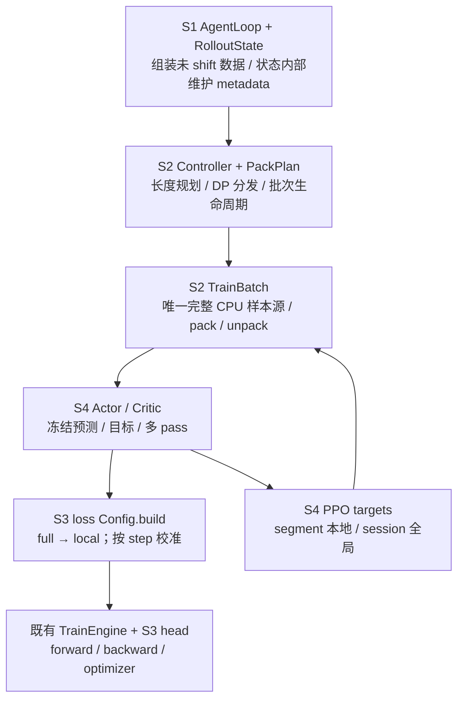
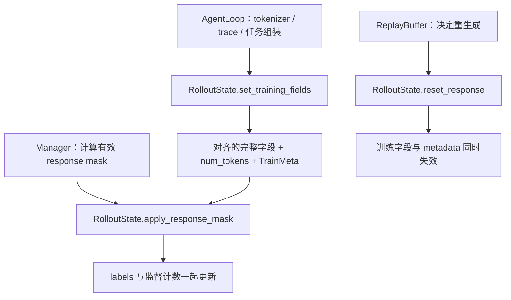
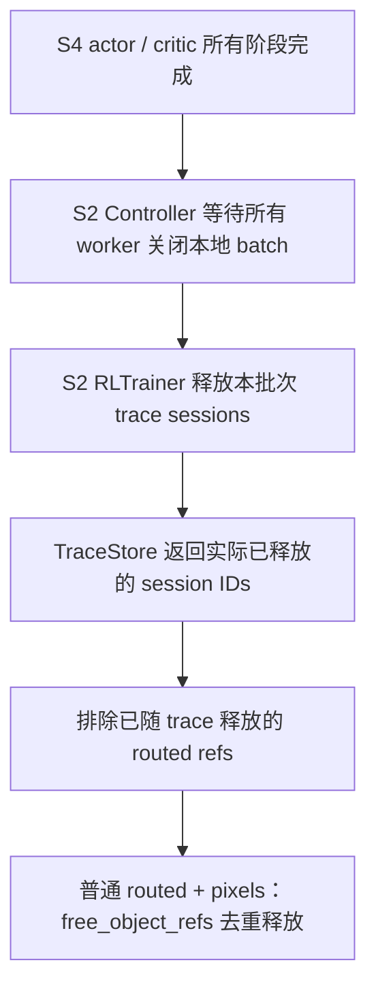
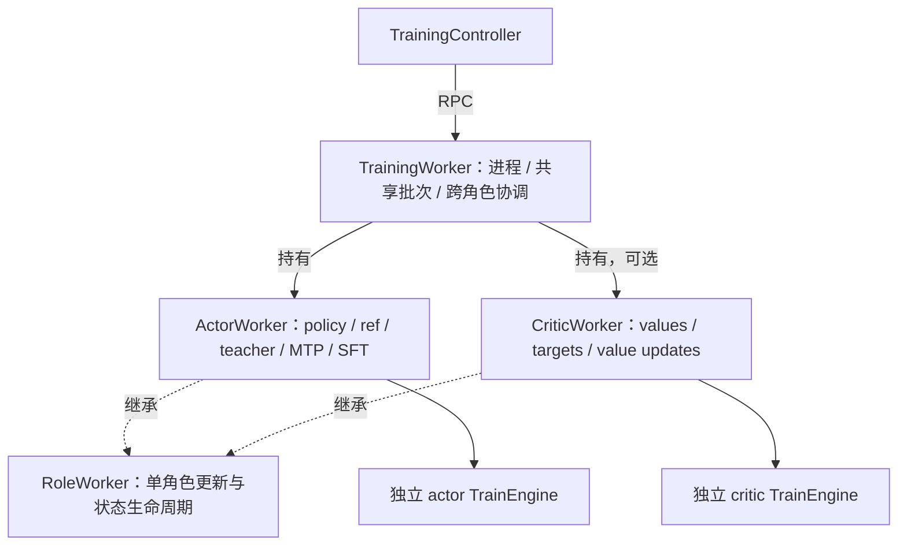
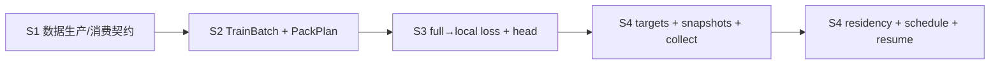

# 四层 RL stack 的整体深化方案

建议按四个稳定概念重新收拢复杂性：**训练数据契约 → 训练批次 → 模型与 loss → PPO 训练阶段**。S1 由既有 `RolloutState` 自身维护训练字段与 metadata 的一致性；新增的主要行为类只有 worker-local `TrainBatch`，用它替代散落的缓存、转换、padding 和目标写入。Controller 保留可读的业务顺序，调用方不再了解 token 布局、GAE 执行位置或角色恢复细节。

配套 [improve_stack_rl.py](improve_stack_rl.py) 按 A–I 节给出 Interface、关键 Implementation 和调用顺序；它是设计伪代码，不是已实现补丁。本文依据源码静态分析，不把待验证风险写成已复现缺陷。

本方案只设计新的统一数据与 checkpoint 契约；所有调用方同步切换，不提供旧序列化格式、旧字段入口或旧 checkpoint 布局的兼容分支。

## 1. 基线、术语与 stack 归属

以 `/tmp/xtuner-stack-rl` 的 `d42ce89f` 为准；以下行号均指该快照。GitHub PR 描述用于确认背景，具体行为以本地源码为准。[PPO PR](https://github.com/InternLM/xtuner/pull/2186)

| 标记 | Stack / PR | 本地提交范围 | 应拥有的职责 |
| --- | --- | --- | --- |
| S1 | [#2102](https://github.com/InternLM/xtuner/pull/2102)，prepare train data | `8e6c1824..d74e4be8` | AgentLoop 产出、训练字段契约、消费时 staleness、Controller 接管训练入口 |
| S2 | [#2185](https://github.com/InternLM/xtuner/pull/2185)，data packing | `d74e4be8..0323086f` | 索引计划、DP 分发、worker-local TrainBatch、物化与完整字段生命周期 |
| S3 | [#2188](https://github.com/InternLM/xtuner/pull/2188)，value head / critic loss | `0323086f..542110e0` | HeadConfig、严格权重加载、value loss、统一 loss 构建契约 |
| S4 | [#2186](https://github.com/InternLM/xtuner/pull/2186)，PPO | `542110e0..d42ce89f` | Actor/Critic、GAE、冻结快照、角色驻留、多 pass、角色续训 |

这是**目标提交归属**，不是按文件路径划层：例如 `TrainBatch` 在 S2 建立，S4 在同一 Module 增加 values/returns；LPT 目前在 S4，建议移回 S2。每层合入后都能独立使用，低层不能 import 高层 PPO 类型。

未发现 `CONTEXT.md` 或正式 `docs/adr/`。沿用代码中的 RolloutState、session、segment、pack、optimizer step、role 术语；遵守现有 [LoadSpec 设计](/tmp/xtuner-stack-rl/docs/design/load_spec_refactor.md) 的约束：HF 映射以 LoadSpec 为单源，HF plan 与 DCP 协议分开。该文件是设计文档，不冒充 ADR；本方案不推翻其决策。

架构词汇：**Module** 封装行为，**Interface** 包含形状、顺序、所有权和失败约定，**Implementation** 留在内部；**Seam** 是可替换位置，**Adapter** 是其具体实现；**Depth** 带来调用方的 **Leverage** 与维护者的 **Locality**。普通调用方不是 Adapter。



## 2. 先保留已经做对的事

当前代码已经有 `RoleWorker/ActorWorker/CriticWorker`、具名 RPC、具体 `CriticWorkerConfig`、Controller finally 释放缓存、共享 padding，以及 segment/session GAE 分入口。S3 已有 `head_config`、`build_head`、`head_fp32`、统一 `to_hf_key_list` 和严格加载例外。不能再把旧的 `call_attached`、`Any` critic 配置、缺少 head 抽象作为当前问题。

`RLDataPacker` 的长度→索引计划 Interface 有 Depth，保留算法；`TokenBatchProto` 继续只做连续 token rows 的传输；Actor/Critic 是共享训练骨架处的两个真实 Adapter。无需算法注册框架、通用 pipeline、字段反射系统、checkpoint manager，或为每次 RPC 再包一层 helper。

## 3. 七项深化机会与明确决策

### 3.1 S1：RolloutState 拥有训练字段、失效与 metadata 的一致性

**Files / Problem。** `agent_loop/agent_loop.py:292–369` 写训练字段和七类 metadata；`data_proto/rl_data.py:260–285,461` 管 reset 与验证；`agent_loop_manager/produce_utils.py:625` 修改 labels 后手工同步监督 token 数；`trainer/controller.py:87–105` 又从 metadata 回退到原字段。一个契约分散在生产、消费、验证三处，Locality 不足。

**Solution / Interface。** 将上述规则收进既有 `RolloutState(BaseModel)` 的具名成员方法，由对象维护自身不变量。仅把外部函数移到同一个 `.py` 文件仍然不够；AgentLoop、producer 和 validator 都要停止手工同步训练字段与摘要。

| Interface | RolloutState 内部负责 | 外部保留的职责 |
| --- | --- | --- |
| `set_training_fields(input_ids, labels, logprobs)` | 验证完整字段；生成 TrainMeta；一起发布字段、训练长度和摘要 | AgentLoop 负责 tokenizer、agent trace、任务语义及普通/自定义响应的完整字段组装 |
| `apply_response_mask(mask)` | response suffix 坐标映射；更新 labels 与监督计数 | Manager 选择当前 step/threshold，沿用既有 staleness 算法计算有效 mask |
| `reset_response()` | 清除响应及其派生训练字段、训练长度和 TrainMeta | ReplayBuffer/rollout worker 决定过期、重试与 partial-rollout 策略 |
| `validate_training()` | 只读检查本样本字段、版本长度与摘要一致性 | `validate_train_group` 保留非空、成员状态与组级错误归因，调用 state 验证后由入口决定丢弃 group |

- 保留 `RolloutState` 的 Pydantic BaseModel、现有 token list 表示与普通可变字段；新增 `train_meta: TrainMeta | None` 作为显式序列化字段。`TrainMeta` 是 `@dataclass(frozen=True)`，只含 prompt/response 长度、监督计数、position layout、presence 和 segment 顺序；不放 tokenizer、worker、锁或 PPO values/returns。
- `num_tokens` 保留为 `RolloutState` 现有的显式字段，是唯一的 shifted training length；TrainMeta 不再复制它，也不增加同名 property。只有 `set_training_fields` 和 `reset_response` 维护其训练生命周期；Controller 在入口验证后只读它。
- `set_training_fields` 接收完整、未 shift 的 ids/labels/logprobs，先验证并生成摘要，成功后再发布；使用同一私有 `_build_train_meta` 实现摘要规则。普通响应与自定义 agent 的已组装字段都通过这个入口。构造错误仍由 AgentLoop 标记 FAILED、producer 丢弃 group，不能变成整个 produce window 崩溃。
- S2 才执行一次 `input[:-1] / labels[1:] / logprobs[1:]`。S1 统计监督 token 时读取 `labels[1:]`，但不保存 shifted 副本；teacher/routing 各自既有坐标转换也只执行一次。
- `apply_response_mask` 要求 mask 与 `response_ids` 等长，只把不保留的位置改成 ignore，不能恢复原有语义洞。它只用 `replace` 更新 `supervised_tokens`，保持 `num_tokens/prompt_length/layout` 等不变。不能在 mask 后重新从非监督位数推导 prompt 长度；验证也沿用首次发布的 prompt_length。
- `reset_response` 同时清除 `input_ids/labels/num_tokens/train_meta` 及既有 response 产物，保留 prompt/multimodal 上下文。清字段前沿用原 reset 的 refs 释放规则，不扩展共享 refs 的释放范围，不在 state 方法中选择重试策略或状态。
- 所有 canonical 训练字段写入点同步迁移到这些方法，删除 AgentLoop 的 `_write_train_meta` 和 producer 中的 labels offset/计数更新。训练专用摘要不再写入 `extra_fields`；Controller 不回退推导缺失 metadata。保留普通 BaseModel 不代表 Python 会禁止任意字段赋值，调用方仍须遵守统一写入入口，训练入口的只读校验负责发现绕过入口的不一致。



**Pydantic / Ray 约束。** RolloutState 仍作为普通 Python 数据对象通过 Ray 参数、返回值或 `ray.put/get` 传输，成员方法在接收进程本地执行，不变成 actor RPC，也不会回写发送方或已 put 的快照；调用链继续返回更新后的 state。方法可增加，字段不能藏进 PrivateAttr；现有序列化/refs 遍历依赖 `model_fields`。不将 RolloutState 整体冻结，也不把 TrainMeta 换成冻结 BaseModel：`replay_buffer._snapshot_nested_objectrefs/_restore_nested_objectrefs` 会对 BaseModel 逐字段 `setattr`，但对 dataclass 已使用 `replace`。不依赖构造/赋值 validator、`model_copy(update=...)` 或反序列化替代成员方法的一致性维护。

**Depth / Tests。** 删除 RolloutState 的这份契约，会让字段更新、失效和摘要规则重新散到多个调用方；私有摘要方法隐藏真实规则，不增加状态 manager。测试公开 `set_training_fields/apply_response_mask/reset_response/validate_training`：首次发布、非法输入不留下半更新、重复 mask、语义洞、无显式 prompt 时长度稳定、reset 后重新生成。再贯穿真实 AgentLoop→ReplayBuffer→take batch 验证 partial rollout、group 失败和 teacher 顺序，并覆盖 Ray 往返、`model_dump` 与 debug snapshot/restore。已有 CPU 最小验证确认了 BaseModel + 普通方法 + frozen dataclass 的传输/快照能力，未将这些待实现的方法视为已通过测试。

### 3.2 S2（S4 扩展）：TrainBatch 拥有完整数据和 pack 往返

**Files / Problem。** `worker.py:314–335,419–687` 同时维护三份缓存状态、shift、seq padding、loss padding、teacher shape 与目标写入；`role_worker.py:313–348`、两个 role 的 `pack_loss_ctx` 仍需理解这些细节。仅加 `BatchTargets` 视图，无法隐藏缓存、布局和生命周期。

**Solution / Interface。** 新建 `trainer/train_batch.py::TrainBatch`，把上述 Implementation 整体迁入，不给旧字段再套一层转发。Worker 只拥有 `batch: TrainBatch | None`；roles 显式接收 `fit(batch)` / `collect_values(batch)`，不从 host 反查缓存。传 batch 的价值是消除隐式依赖，不是把恒等参数传完又读 host。

| Interface | 封装的规则 | 归属 |
| --- | --- | --- |
| 构造：states + local plan + batch attrs | 验证、一次 shift、CPU 样本、teacher targets、只保存 refs | S2 |
| `materialize(pack) -> FullPack` | seq/字段同一顺序，完整 CPU 拼接，pack padding，MRoPE 与 routed padding | S2 |
| `unpack_rows(pack, full_rows)` | 裁 pack padding、按完整样本长度逆映射，不按 action mask 压缩 | S2 |
| `set_advantages(scalars_or_rows)` | GRPO 标量广播、长度验证、无效位置置零 | S2 |
| `set_old_values(rows)` / `set_ppo_targets(adv, ret)` | 冻结旧 value、完整覆盖、成对目标安装，returns 不归一化 | S4 扩展 |
| `require_targets(role)` | 进入训练前一次确认完整目标；空 DP 仍允许参与 padding/collective | S2 actor；S4 扩展 critic |
| `close()` | 清本地样本、目标、物化缓存；不对共享 refs 强制 free | S2；S4 增加目标清理 |

`FullPack` 是普通数据记录：`indices / lengths / full_data`。`full_data['seq_ctx']` 与 token 字段覆盖相同完整 pack，padding metadata 用于逆映射；它不是另一个拥有缓存的 manager。actor snapshot 仍属 ActorWorker，不能把 SP-local 行混进 TrainBatch 的 full rows。

Implementation 中字段列表是有限、明确的：labels 填 ignore，浮点目标填 0，teacher index 填 -1；teacher 的 sampled/TopK 形状从已有 distillation 契约取得，不能用 `top_k is not None` 推断所有模式。critic 构建 loss 时只将所需字段搬上设备。先保持 CPU packing 语义，不为省一次拼接引入 lazy-field 框架。

同一轮 batch 的 pack identity / SP topology 固定；critic 多 pass 可以重排 pack 或改变 step 分组，不能重新组合 pack 内样本后继续复用旧 SP-local snapshot。S2 的 `PackPlan` 收拢原 `controller._build_pack_plan` 中 global↔local 索引与统计；只做索引数学，不持有 Ray handles、tensor targets 或算法对象。

**Depth / Tests。** 删除 TrainBatch，shift、padding、反向拆行和目标规则会重新出现在两个 role，具有实际 Leverage。公开 materialize/unpack 往返测试覆盖 MRoPE、sampled/TopK teacher、routed refs、空 pack、重复 pass；使用真实 SequenceContext 和 TokenBatchProto。

### 3.3 S2 / S4：物化与 refs 生命周期，按真实范围封装

**Files / Problem。** `role_worker.py:360–446` 是 CPU prefetch + H2D/SP 的公共路径，`critic_worker.py:113–146` 又自行 pack/搬运；teacher 阶段 `actor_worker.py:391–429` 会持有整批设备 contexts。当前 iterator 不代表端到端只有一个 GPU pack；训练还会缓存一个 optimizer step。refs 的显式释放分别在 actor finally 与 Controller，不能靠 `cached_samples=None` 解释清楚。

**Solution。** S2 统一为同步 generator `iter_cpu_packs(batch, indices, resolve_refs)`；S4 所有 role 路径共用。调用方每取一项，才执行当前 pack 的 `TrainBatch.materialize` 和 CPU refs 解析，随后使用既有 `seq_ctx.copy().to().split()` 做设备准备。不改变 SequenceContext 的 Interface。

```python
def iter_cpu_packs(batch, indices, resolve_refs):
    for pack_indices in indices:
        pack = batch.materialize(pack_indices)
        resolve_refs(pack.full_data["seq_ctx"])
        yield pack
```

- 删除预取线程、队列、stop/drain/join、`prepare_all` 两种路径，以及物化阶段的 `dist.barrier()`。`ray.get` 保留有限超时，异常直接沿当前调用栈传播；提前退出后没有后台物化任务需要终止，batch/ref 生命周期仍由外层 scope 管理。
- actor 冻结阶段、ref/teacher、actor/critic 训练和 critic value 收集都按相同顺序取 pack。CPU 准备进度可以不同；各参与 rank 仍须保持模型 collective 的次数和顺序，同一 SP 组的 pack 顺序一致，空 pack 不跳过。
- generator 不预先保留整批 CPU 打包副本；训练调用方仍按一个 optimizer step 聚合 ModelItems 后统一校准，teacher 仍按既有 Interface 聚合整批 contexts。内存驻留范围由这些真实消费者决定，不能因此承诺所有路径都只驻留一个 pack。取消显式 CPU 预取重叠，吞吐影响留给真实训练测量。
- critic 在 SP-local forward 后，仅在 SP group gather **标量 values**，去 SP padding，再由 TrainBatch 去 pack padding并拆完整行。所有 rank 都走同样的前向/gather，包括空 pack；GAE 从完整行开始。
- teacher 保留 whole-batch Interface 和模型每阶段只上下卡一次。若要变成流式，必须先扩展真正的 teacher Module 并验证峰值；不能改 iterator 名称就宣称解决显存问题。
- Controller 的 loaded-batch scope 只管理 payload refs 和 worker 本地 batch：每 DP 一个 payload ref、replicas 共享；所有业务 RPC 完成后，等待各 worker 的 `release_train_batch` 确认。`TrainBatch.close` 只清本地样本/目标，role 在解析阶段和 finally 都不显式 free 远端 refs。
- 远端 pixels/routed refs 的释放统一放到外层 `RLTrainer._release_train_batch_resources`（伪代码 I 节），在 `Controller.fit` 成功返回后执行。原方案的 `exclusive_transferred_refs` 没有构造来源，现删除该占位，使用现有 state 字段与 TraceStore 的实际释放结果，不新增所有权清单或 refcount 框架。
- 部分 load、训练或本地 batch release 失败时，不执行远端资源的成功释放流程。Controller 仍尝试清理各 worker 本地 batch，并保留原始异常；失败退出若需要显式 free，必须先停止仍在运行的消费者，不能在外层 finally 无条件强删，也不新增 GPU barrier 或 retry。

**现有 trace-store 约束的证据。** [RLTrainer._init_train_worker_config](/tmp/xtuner-stack-rl/xtuner/v1/train/rl_trainer.py:676) 明确在使用 trace-store 时设置 `free_rollout_routed_experts_in_worker=False`；[_agent_loop_manager_uses_trace_store](/tmp/xtuner-stack-rl/xtuner/v1/train/rl_trainer.py:93) 当前借用 `requires_rollout_proxy` 判断，注释说明目的是保护“一拆多”的共享 refs。这是 manager 级判定，不是每个 ref 的所有权事实。当前 actor finally 也受此开关控制；[训练成功后](/tmp/xtuner-stack-rl/xtuner/v1/train/rl_trainer.py:1029) 才由外层释放 trace：共卡原来 `release_all`，分离部署仅释放本批次 session。

**修订后的释放顺序（S2 建立，S4 将 critic 纳入同一批次）。**

| 资源 | 读取期间 | 释放时机与 owner |
| --- | --- | --- |
| worker 的 CPU samples / values / targets | actor/critic 共用 TrainBatch | Controller 等业务结束，调用所有 worker 的 `release_train_batch` |
| trace-store 的 routed refs | 每个阶段可以重复 `ray.get`，不提前 free | RLTrainer 先调用现有 `_release_trace_sessions`；TraceStore 释放本批次 session 并返回实际释放的 IDs |
| 普通 routed refs | 每个阶段可以重复 `ray.get`，不提前 free | RLTrainer 收集 session 不在上述返回集合中的 `state.routed_experts`，统一释放 |
| pixels refs | 保留到整个批次消费结束 | RLTrainer 从 `state.mm_info['pixel_values']` 收集，与普通 routed refs 一次交给已有 `free_object_refs` 去重释放 |

该判断复用现有 `release_and_discard_rollout_groups` 的“先释放 session，再处理剩余 routed refs”规则，但成功训练不调用 discard，也不重置 RolloutState。普通任务可能有 session_id；仅凭 session_id 非空不能跳过 routed 释放。多个 trace segments 共享 refs 时，由一次 session 释放处理，不再直接重复 free。普通任务与 trace 任务混合、debug 恢复后 store 中不存在 session，也走同一个流程；session RPC 失败不能当作“不存在”继续 free。

删除 worker 的释放分支及 `free_rollout_routed_experts_in_worker` 配置/自动赋值；角色不再决定远端资源所有权。训练成功路径统一替换原 `_release_trace_sessions_after_train_batch`：共卡也只释放本批次 session，分离部署保留其他正在生成或等待消费的 sessions；不要在新路径后再调用旧的 `release_all`。沿用现有 group 消费约束：释放的 session 已无本批次之外的活跃消费者，同一 session 的 segments 不跨未来 batch 留存；本方案不引入跨批 session 引用计数。Eval、rejected/expired group 的既有清理入口保持。



**Depth / Tests。** 同步 iterator 是两个 role 共用的 Implementation，不再引入预取模式或可替换 Adapter。测试从公开 worker/Controller 的成功、失败、提前退出路径检查 pack/value 结果、collective 顺序和 refs 生命周期，避免只测 generator 的调用次数。

### 3.4 S3，S4 接入：loss builder 统一 full→local，head 保持现有单源

**Files / Problem。** `actor_worker.py:466–530`、`critic_worker.py:236–282` 手工 build/to/split；CE/MTP/critic 的 batch 校准约定也不同。调用方必须知道哪些字段 full、哪些已经 local。相比之下，当前 `model/base.py:196,436,650,1990` 的 head config/key mapping 已大幅收拢，不值得再加 HeadPolicy。

**Solution / Interface。** 采用 `ppo_sp_ctx_v2.md` 的核心布局契约，但把改动归到 S3 的 loss Module，并同步 SFT/混合 SFT/现有 RL 调用方：

```python
ctx = loss_cfg.build(full_data, sp_mesh=mesh, device=device)
ctx.bind_actor_snapshot(snapshot)  # S4 actor RL：恢复已冻结的 local 数据，绝不再次 split
LossContext.build_batches(contexts_of_one_optimizer_step)
```

- `build` 输入始终完整；内部计算完整样本权重，再 pad/split/to，返回 local context，且不做 collective。CE/Critic Kwargs 的 `sp_split/to` 必须同步覆盖新增的 `loss_weight`，贯通 ignore_idx；不能只搬 labels 而把 weights 留在 full CPU。full data 不被修改。现有 labels shift 不再做第二遍。
- CE sample/square 权重依赖完整样本；MTP 每个 depth 先按真实 sample 边界 roll，再 pad/split，不从 actor 被 IS 修改的 labels 建立。LogProb 读取 context 也接受 full data。
- `[B,L,K]` 只切 token 维；critic 只 squeeze value 输出的末尾通道，不无条件 squeeze `[B,S]` targets。新代码要保留 S3 已修好的 shape 行为。
- `build_batches` 只收 contexts，校准恰好一次；分母覆盖当前 optimizer step 的全部 microbatches。沿用各 loss 的 WORLD/DP/SP 与 FSDP 梯度约定，不新增除 SP size 或 microbatch 数；Oreal 正负分母等数学不被统一掉。
- 零监督 rank 仍参加 collective；全局零监督由所有 rank 一致跳过更新或产生零 loss，延续各训练路径既有约定。不能本地提前 return。不同 loss/depth 的 collective 顺序一致。
- SFT、dense/MoE/compose 的组合入口继续用既有 `build_loss_ctx_batch`，传递 effective loss config；混合 SFT 的独立配置不丢失，不原地改共享 model config。

S3 head 只做必要收尾：保留 value head 自动 untie 的既有配置归一化，继续拒绝 value head + MTP；严格加载根据映射后的**全局 checkpoint keys**决定加载已有 critic head，还是允许 actor→critic 的 head 初始化例外。这套判断已经存在，不是本方案新增：

| 现有源码 | 作用 |
| --- | --- |
| [BaseModel.from_hf](/tmp/xtuner-stack-rl/xtuner/v1/model/base.py:649) | 加载开始刷新 LoadSpec，依次加载参数、处理缺失 critic head |
| [_critic_head_hf_keys](/tmp/xtuner-stack-rl/xtuner/v1/model/base.py:736) | 从 `lm_head.weight` 的 LoadSpec 取得应用映射后的 `global_hf_keys` |
| [_head_load_exceptions](/tmp/xtuner-stack-rl/xtuner/v1/model/base.py:1988) / [_load_params](/tmp/xtuner-stack-rl/xtuner/v1/model/base.py:2019) | 将 head keys 与 checkpoint `weight_map` 比较，仅在 value head 完全缺失时放行其缺失和 actor head 的多余 keys；其余仍做严格检查 |
| [_init_missing_critic_head](/tmp/xtuner-stack-rl/xtuner/v1/model/base.py:757) | 按全局 keys 决定初始化，随后更新 loaded/unloaded/missing；不依赖各 rank 的 loaded 集合 |

**本方案的改动**是让严格检查和初始化复用 `_head_load_exceptions` 的同一次判断，不新增 `_resolve_head_transition` 或决策对象；伪代码 C 节已展开。完整 head 直接加载；完全缺失才初始化；部分缺失直接报错，不走初始化例外。全局 keys 保证 FSDP 空 shard 的 rank 也做出同一决定，避免只有部分 rank 进入初始化 collective。刷新 LoadSpec 和初始化后更新返回集合都是现有行为，继续保留。

骨干缺 key、shape 错误仍失败；[S4 CriticWorker 当前使用 `strict=False`](/tmp/xtuner-stack-rl/xtuner/v1/rl/trainer/critic_worker.py:87)，应改为 `strict=True`，让 Model 处理 head 的局部例外。不引入第二套 key mapping 或 `head_type` 文件标记。HF 导出保留实际 value head 和 config；DCP 续训交给 S4。

**Depth / Tests。** Loss Config 是真实 Seam，CE/critic/RL 等是不同 Adapter；head 的 LMHead/ValueHead 同样已有真实差异。测试公共 build→model→engine 路径，对齐 SP=1/2 的 loss、梯度和一次更新，覆盖空监督、MTP/IS、B>1 且 S=1、非整除长度及 compose HF round-trip。

### 3.5 S4：PPO targets 隐藏完整准备阶段，数值算法不接触 Ray

**Files / Problem。** `controller.py:442–544,593–670` 在估计、critic 分发、actor 分发三处解释 scope，四元返回值靠 None 暗示目标位置；`critic_worker.py:148–225` 又包含 moments 和归一化。仅把 tuple 改 TypedDict 没有减少调用方知识。

**Solution。** 在 Controller 内深化一个完整方法 `_prepare_ppo_targets(prepared, plan) -> TokenStats`。后置条件只有一个：**所有 worker 的 TrainBatch 均拥有冻结 old_values、advantages、returns**。fit 随后只调用无目标参数的 critic_fit / actor_fit。方法隐藏 value 收集、scope、DP 映射、replica 去重、归一化和原子安装；方法已足够，不再引入只有一个 Adapter 的 PPO manager。

数值侧将 `TokenAdvantageEstimator` 与既有 scalar `AdvantageEstimator` **平行定义**。GAE 与 DecoupledGAE 是两个真实 Adapter，共用轨迹输入→未归一化 `(advantages, returns)` 的 Seam。不要让 token 类继承 scalar 后让 `compute` 抛错。Config 返回二者 union，构造 Controller 时分派一次，并验证 critic/estimator 配对。

| 模式 | 计算和传输 | 必须保持 |
| --- | --- | --- |
| GRPO / RLOO / OPO / PassK | Controller 保留原 group/session 聚类→标量 advantage→按 plan 安装 | group/session 映射与指标口径不改；不构造 critic |
| segment GAE | 所有 worker 收集并缓存 full values；本地算目标；每 DP 一个代表贡献 moments | 全 rank 参与归约；只统计有效 action token；returns 不归一化；token 不回传 Controller |
| session GAE | 所有 worker forward；每 DP 代表返回 values；plan 恢复原样本顺序；数值 Module 按 session/segment 顺序拼、算、拆；按 DP 一次下发 adv+ret | 不按 pack 顺序拼 session；不能对每段独立 GAE 后拼结果 |

session 拼装留在 `advantage/gae.py`，不是 Controller 的张量胶水；它调用同一个轨迹算法。DecoupledGAE **继续只支持 segment**，不在架构整理中自动开放 session。GAE 当前是末 action 放 reward、observation 跳过、轨迹末尾零 bootstrap，算法输出的非 action returns 为零；安装阶段不再另改 returns。本方案保留这些语义，不声称增加 truncation/bootstrap 支持。未来若扩展，要先新增显式终止语义。

统一 PPO 日志为归一化后有效 action token 的 sum/count/min/max；空代表 count=0，不用 0 污染 min/max。GRPO 现有按样本统计仍保留并标明单位。segment/session 都只归一化 actor advantage 一次，固定 old_values 和 critic returns。

**Depth / Tests。** 删除准备方法会把 scope 和分发重新散到三处。数值测试直接调用 estimator；映射与安装测试通过真实 Controller.fit/worker 路径，覆盖 session 跨 DP、乱序 segment、空 DP 和非代表 replica，不用测试替身迫使生产代码恢复 `.remote`/直调双分派。

### 3.6 S4：Actor 的冻结阶段产物是完整契约

**Files / Problem。** `actor_worker.py:279–429,466–530` Stage A 修改 context，再在 Stage B 重建。当前 old/ref/teacher 分别写 `_staged`；后续消费还依赖 IS mask/weights 等变更。数据搬 CPU 后仍是 SP-local，不能从设备推断布局。

**Solution。** 保留 ActorWorker，使用 typed `ActorSnapshot` 数据记录：最终 labels、old/ref logprobs、IS weights、teacher logprobs/target IDs。快照集合是一次 `fit` 的局部变量 `snapshots_by_pack: dict[tuple[int, ...], ActorSnapshot]`，key 为 `pack.indices`，value 为该 pack 的冻结数据；不再挂到 `self._staged` 上。old-policy 阶段返回集合，ref/teacher 显式接收并补充，训练阶段显式读取：

```python
snapshots_by_pack = self._collect_old_policy_snapshots(batch)
try:
    self._stage_ref_logprobs(batch, snapshots_by_pack)
    self._stage_teacher_outputs(batch, snapshots_by_pack)
    return self._fit_policy_then_sft(batch, snapshots_by_pack)
finally:
    snapshots_by_pack.clear()
```

`_capture_snapshot(ctx)` 只负责按同一规则冻结并返回一条记录，不隐式写 worker 缓存。每个阶段先用 `ctx.bind_actor_snapshot(snapshots_by_pack[pack.indices])` 恢复此前结果，再补入本阶段字段并替换记录；最后才校准 loss。这个名字也明确包括 IS labels/weights，而不仅是 predictions。所有 snapshot 张量均已 SP-local，搬到 CPU 不会变回 full，绑定时只搬设备，绝不再 split。

局部集合只供当前 worker、当前 batch、固定 pack/SP 布局使用；不跨 RPC、batch 或拓扑复用。`fit` 的 finally 清空集合，避免异常 traceback 保留整批缓存；不新增 snapshot manager 或 batch-id 注册。先完成所有 old/ref/teacher forward，再执行任何 actor update，不能为节省缓存逐 pack forward→update→下个 pack。actor 与 critic 独立参数，因此现有“critic 更新后才做 actor 冻结阶段”可保留。critic 在任何 critic update 前完成全部 value 收集。

IS mask 只作用于主 actor context，out-of-place 更新；MTP 从原始完整标签建立。ref/teacher 以 stage 为单位切换，不逐 pack 上下卡。SFT tail 不共享 RL snapshot，继续使用自己的 effective config。

伪代码 E 节展开 `_fit_policy_then_sft`：按 `batch.plan.steps` 同步物化当前 step，恢复同一批 snapshots，经 `_build_step_input` 校准后交给共享 `_train_update`；完成全部 policy updates 后，`_rollout_step` 仅增加一次，再按既有频率调用 `_fit_sft()`。更新计数/scheduler 留在 RoleWorker，SFT 数据、loss 构建和日志走既有独立路径；不在外层重复 build_batches 或更新 scheduler。

**Depth / Tests。** 只给 dict 起类型名不够，保存/绑定完整契约才有 Depth。测试公开 actor fit 的实际 loss/梯度和目标：强制 IS 丢 token，验证 Stage B 仍丢弃且源 labels/MTP 不变；多 step 检查 old policy 不随更新变化。

### 3.7 S4：角色、更新计划与 checkpoint 的唯一 owner

**Files / Problem。** `worker.py:401,846` 的 role 切换与 actor-only offload/onload 有不同语义；`critic_worker.py:311` 的 `optimizer_steps` 只作上限检查，`num_passes` 在 per-pass=None 路径不展开；`role_worker.py:291,462` 持有全局训练步号/scheduler，但续训还需要跨 host/trainer 理解。

**类关系（S4；批次封装依赖 S2）。** 保留一层组合、一层继承：`TrainingWorker` 是 Ray 进程宿主，持有同进程的 `ActorWorker` 与可选 `CriticWorker`；后两者继承 `RoleWorker`。四个名称暂时保留，避免仅为命名扩大修改。



| Module | 自己拥有的职责与状态 |
| --- | --- |
| TrainingWorker | 初始化进程组/mesh；构造角色；管理共享 TrainBatch；具名 RPC；跨角色驻留与 checkpoint 目录分派 |
| RoleWorker | 每个角色各自的 engine、scheduler、更新计数、设备搬运与 save/resume；公共 `fit(batch)` 契约 |
| ActorWorker | actor 冻结阶段、策略更新、reference/teacher、MTP、SFT、权重同步；snapshot 是 fit 局部变量 |
| CriticWorker | value 收集、segment targets、critic 多 pass 更新；通过 TrainBatch 安装完整 values/targets |

收紧现有反向依赖：[_cached / _plan / packing](/tmp/xtuner-stack-rl/xtuner/v1/rl/trainer/role_worker.py:310) 依赖 `self.host` 的部分迁入 TrainBatch，role 方法显式接收 batch；mesh/device/rank/seed/logger 与必要配置在构造时传入，role 不持有整个 TrainingWorker，也不回调其 RPC。RoleWorker 不包含 actor 的 IS/teacher 规则或 critic 的 GAE/pass 规则；两者各自组织流程，只复用一次 update 与状态生命周期。具体 loss 的指标整理保留角色差异，不能假定 critic/SFT 具有 actor 的 RL loss 配置。

**Solution A：驻留。** TrainingWorker 的 `set_residency(model_role, optimizer_role)` 负责**跨角色**的切换：先卸载所有非目标角色，再加载目标。参数是意图，engine/RoleWorker 的真实 placement 是事实；删除 `_current_role` 影子状态，不再增加 RoleResidency 的两槽 owner 表。重复调用使用现有幂等搬运，不额外卸载目标。

权重同步明确只请求 actor model；训练要求目标 model+optimizer；整机让位明确请求 `(None,None)`。RPC guard 检查实际所需部分，不只查 model owner。**角色内部的临时卸载由该角色负责**：teacher 阶段通过继承的 offload/onload 方法操作自己的 actor engine，正常完成后恢复 actor；不回调 host、不触碰 critic。这里依赖 worker 的训练/驻留 RPC 串行执行，不能在 actor.fit 中途并发切换角色。异常继续向外传播，由外层终止本轮，不强行恢复 GPU 驻留。

伪代码 E 节 `_stage_teacher_outputs` 明确执行：卸载 actor optimizer/model → 构建整批 local contexts 并绑定快照 → teacher 计算 → 更新 CPU snapshots → 清理临时 GPU contexts → 恢复 actor model/optimizer。现有 TrainTeacherManager 自己在 finally 中卸载 teacher；ActorWorker 的 finally 只清理临时数据，actor 恢复放在成功路径。H 节展开继承的四个搬运方法，全部只操作当前角色的 `self.engine`。ref 阶段也已展开，保留 reference 每阶段一次上下卡。

这修订了原文“teacher 也调用 host 的驻留入口”的要求，避免为此重新引入 role→host 回调。reference/teacher 自有模型仍由其现有 Module 管理，不能声称进程里任何时刻只有一个模型。构造 actor→offload→构造 critic 的内存顺序保留。

**Solution B：更新计划。** S2 PackPlan 拥有 actor 默认 step 分组；S4 critic 只拥有自己的多 pass 规则。删除 critic 的重复 `optimizer_steps` 和 `optimizer_steps_per_pass=None` 特例，只保留 `num_passes`（pass 重复次数）与默认 1 的 `optimizer_steps_per_pass`（每个 pass 的 update 上限）：每个 pass 都摊平本地 packs，首轮保持 pack 顺序、后续 pass 用 `pass_order` 洗牌，再由 `partition_indices` 切成至多 `optimizer_steps_per_pass` 次 optimizer update；所有 DP 保持同样 update/pack 数。`optimizer_steps_per_pass=1` 表示该 pass 的全部 packs 一次 update，不是每个 pack 一次。每轮旧 values 固定；全局监督数为零才共同跳过 update。

该修订删除的是 `per_pass=None` 时“沿用 actor 分组并忽略 `num_passes`”的隐式语义，必须单独验证更新数与梯度，不能宣称完全不改数值。仓库内两个 recipe 显式设置 `optimizer_steps_per_pass=8`，`rl_ppo_gsm8k` example 的 actor plan 只有 1 步，现有配置行为不变；外部配置若只写 `optimizer_steps` 而未写 `optimizer_steps_per_pass`，update 次数会从 plan 步数变为每 pass 1 次，迁移时须显式补上。scheduler 仍按成功 optimizer update 前进，只保留全局训练步号，不重复记录 attempted/successful 计数，`scheduler_steps = total_steps × num_passes × optimizer_steps_per_pass` 成为唯一口径。S4 对 engine 做一个小扩展：`step_optimizer` 返回实际是否应用更新，删除 `schedule.py` 对 skip 条件的重复推断；现有返回值是 grad_norm，实施时必须审计并迁移所有读取返回值的调用方。**保留当前 scheduler 默认值**；若将 critic 的 1e6 改成 None，那是训练策略变更，应单独讨论，不夹带在重构中。

**Solution C：续训。** RoleWorker.save/resume 包含 engine weights/optimizer、scheduler、全局训练步号及恢复所需 RNG；ActorWorker 另保存 SFT dataloader 状态。host 只管统一的 `actor/critic` 目录；RLTrainer 继续管理 rollout/replay/训练步与完成标记。只在批次完成的既有保存点发布 checkpoint，不把 mid-batch snapshot 放入续训协议。

resume 在新构造的 role 上执行：`load_scheduler=False` 使用新配置的初始调度，`True` 恢复成功 update 进度，并校验当前调度配置与保存的 `lr_cfg/scheduler_steps` 一致。LambdaLR state_dict 不保存 lambda 闭包，不能只恢复 step 就声称未来 LR 一致。最终 optimizer LR 必须与所选 scheduler 一致，不受 optimizer args 加载开关意外覆盖。新格式要求 role_state 完整，不增加缺失文件或计数的回退，也不能拿 rollout step 推断 optimizer step。RNG 若由现有 engine/trainer 保存，保留唯一 owner，由 host 协调，不重复保存后互相覆盖。HF 导出是模型产物，继续与完整续训分离；更新上层产物发现路径。

**Depth / Tests。** 不新增 manager，深化已拥有状态的 Module。真实 save→重建→resume 比较后续 LR、参数和 SFT 游标；角色测试检查公开操作后的实际 placement，覆盖 teacher 阶段后 actor 正常恢复、critic 保持卸载，以及失败退出；critic 测试检查实际更新数与参数，不断言“配置类里不存在某字段”。

## 4. 对已有方案的取舍

| 参考 | 采用 | 修订 / 不采用 |
| --- | --- | --- |
| [SP v2](ppo_sp_ctx_v2.md) | full 源数据、builder 内 split、MTP 独立、SP value gather、contexts-only 校准 | 补全 S1/S2 所有权与 S4 snapshot/lifecycle；不把旧版已修的 critic shape 当新缺陷 |
| [DS 1/2/3](.claude/worktrees/pr2186-improve-ds/pr2186_improve_by_ds_123.md) 及同名 `.py` | 区分 scalar/token、共享物化、统一目标写入 | token/scalar 平行；不自动扩 Decoupled session；TrainBatch 替代 8-method targets 视图；物化统一同步逐 pack，不保留多种 residency 模式或后台预取；不把调用方叫 Adapter；不以私有 iterator 测试作主要验收 |
| [DS 4/5](.claude/worktrees/pr2186-improve-ds/pr2186_improve_by_ds_45.md) 及同名 `.py` | 删 critic 重复步数、驻留收口、早校验 | 不加第二份 owner 表；删除重复步数后 actor=4/critic默认应成功沿用，不能仍写构造报错；删除 `per_pass=None` 特例，`num_passes` 始终生效；默认 scheduler 不变 |
| [Sol](pr2186_improve_by_sol.md) | 完整 snapshot、完整角色续训、targets-ready 后置条件 | 扩展到 S1–S3；将数据/pack 收进 TrainBatch；量化 collective、refs 和跨层迁移约束 |

## 5. 分层实施与可独立验收

| 顺序 / 提交位置 | 落地内容 | 该层完成标志 |
| --- | --- | --- |
| S1 / #2102 | RolloutState 的发布/mask/reset/验证与 frozen TrainMeta；迁移 AgentLoop 和 producer 写入点 | 已有 GRPO 数据路径、partial rollout、multi-task、staleness 保持；Ray/debug 序列化通过 |
| S2 / #2185 | TrainBatch、PackPlan 映射、本地 batch scope、RLTrainer 远端 refs 释放、同步逐 pack iterator；LPT 移到此层 | actor-only GRPO/OPD 可独立训练；pack 多字段往返、trace/普通 refs 生命周期正确 |
| S3 / #2188 | loss builder 全量迁移、SFT 组合入口、现有 head 严格契约收尾 | SFT value loss 和 HF/DCP 基础路径独立验证；无 PPO import |
| S4 / #2186 | TrainBatch 目标扩展、Actor/Critic 接入、targets phase、SP collect、snapshot | segment/session PPO、GRPO/OPD 共存，loss/梯度与冻结快照符合契约 |
| S4 后续小提交 | 驻留入口、critic schedule 明确化、完整 role checkpoint | 更新数、offload、续训与不中断参考一致 |

当前 RoleWorker 拆分已在 S4：S2 先在原 worker 内使用 TrainBatch 和同步 iterator；S4 拆角色时移动共享训练骨架，避免为了重排 stack 让 S2 预先依赖 CriticWorker。S3 调整 loss Interface 时必须同步该层所有既有调用方，不能只改 PPO 顶层。各层同时切换相关调用方，删除外部训练字段写入、摘要魔法键和手工 split，不保留转发入口或双写路径。

`math_rule.py`、tokenizer 的 data_source 行为等若无直接 PPO 依赖，从这四层拆到独立 PR；涉及 PPO recipe 的调用仍指向既有可用 judger。LPT 是 S2 的真实策略扩展，可保留为独立提交。不要为满足“全覆盖”把无关改动塞进 PPO Module。



验收以公共 Interface 与真实路径为面，不为这份伪代码写模拟训练测试：

1. 数据：公开 RolloutState 方法的发布/mask/reset/只读验证，普通/多模态/agent segment、partial 过期后重生成、无显式 prompt 时 mask 不改长度、group 失败和 teacher 时序；真实 Ray 往返、model_dump 与 debug snapshot/restore。
2. packing：全部现存策略、DP 重排、padding-only rank、MRoPE global-amax 续写、路由/teacher 多字段拆回一致。数据平面去重与模型 collective 参与者分开测试。
3. loss：SP=1/2、奇数长度、sample 跨 shard、多 microbatches、无监督 shard；比较真实 loss、最终梯度、一次更新，保留各 loss mode 的覆盖。
4. PPO：session 跨 DP 与 segment、rollout/session identity、乱序 segment、空代表、GAE 解析数值、IS mask 跨阶段保留、固定 old policy/value、多 pass 更新计数。
5. 生命周期：load 部分失败、同步物化/refs 解析失败、critic/teacher/actor 异常、逐 pack 消费提前退出；普通 routed、同 session 多 segments、多 replicas、pixels 共享、trace/普通任务混合、debug 恢复无 session。成功后目标 refs 已释放，分离部署其他 sessions 仍可读；任何阶段失败不在消费者仍活跃时强删。使用真实本地 Ray/TraceStore/CPU 数据 Module，外部推理/teacher 服务才 mock。
6. 续训：actor-only 和 PPO，scheduler 开关×optimizer args 开关、统一角色目录与 HF 产物路径、SFT tail；后续更新对齐不中断参考。
7. 最后使用已有 GRPO/OPD/PPO 端到端路径做精度回归；不以新结构的内部 mock 测试替代。需要 GPU 时按用户约定先获取 `/mnt/shared-storage-user/zhaopenghao/github/xtuner/zdev/gpu_lock.sh` 锁，Python 使用 `pt29_glm2`，lmdeploy 加入指定 PYTHONPATH。

## 6. 最终收敛

这套方案使规则有唯一 owner：**S1 由 RolloutState 维护训练字段及 metadata 的一致性与生命周期，S2 保证完整数据与 pack 往返，S3 保证 loss 布局与 head 契约，S4 保证 PPO 目标、冻结阶段和可恢复更新。** Controller 只表达训练顺序，role 只表达本角色的工作；删除任何一个深化后的 Module，真实复杂性都会重新泄漏到多个调用方。

新增类的成本集中在一个 TrainBatch 和少量数据记录；其余优先深化已有类/函数。数值语义保持、显式行为修订、后续扩展分别列清，便于四层逐一评审和验证。
