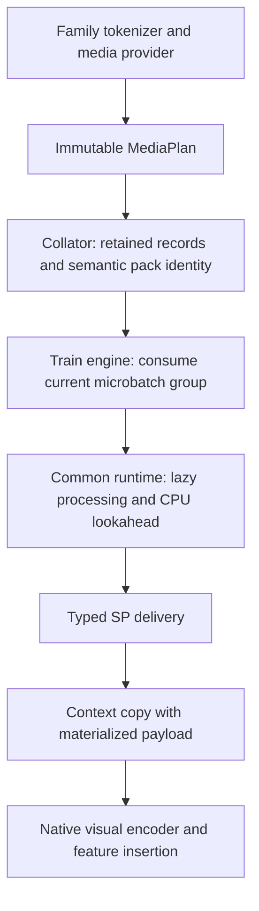

# Unified media pipeline

`TrainerConfig.media_pipeline` provides one opt-in entry for lazy media
materialization, sequence-parallel (SP) delivery and asynchronous CPU lookahead.
GLM-5.3-Flash, Qwen3-VL and Qwen3.5 image paths use the same runtime while keeping
their native tokenizer, processor and model semantics. The pipeline is disabled
by default.

## Architecture



The common runtime owns scheduling, ordered assembly, resource reservations,
SP communication, cancellation and shutdown. Providers own native processing and
output layout. Token expansion, image grids, MRoPE, video decisions and visual
feature insertion remain family-specific. Runtime and transport do not dispatch
on model names.

## Configuration

Pass a `MediaPipelineConfig` to the existing `TrainerConfig.media_pipeline` field.
Trainer and dataloader construction forward it to participating tokenizer
configurations and collators.

```python
from xtuner.v1.datasets.media import MediaPipelineConfig

# Default: existing native processing.
native_media = MediaPipelineConfig()

# Set paths and limits for the dataset and machine before constructing this config.
def lazy_sp_media(manifest_path, host_budget_bytes, transport_budget_bytes):
    return MediaPipelineConfig(
        enabled=True,
        materialization="lazy",
        per_image=True,
        decode_threads=2,
        distribution="sp_leader",
        prefetch_batches=1,
        max_inflight_bytes=host_budget_bytes,
        max_pending_tasks=2,
        max_transport_bytes=transport_budget_bytes,
        source_manifest=str(manifest_path),
        unsupported_policy="error",
    )
```

Local processing and no lookahead can be selected independently. SP delivery and
lookahead require lazy materialization. Enabled pipelines require explicit byte
and task limits; SP delivery additionally requires a per-rank transport limit.
Lazy processing requires a source manifest. `decode_threads` is bounded to 1–16,
`max_pending_tasks` must cover it, and `prefetch_batches` is either 0 or 1.

An unsupported tokenizer or collator is rejected when enabling the pipeline.
With the default disabled configuration, the existing native path is retained.

## Prepare image metadata

The built-in providers consume a versioned image manifest binding source content,
geometry, decode eligibility and the exact processor profile. A path alone does
not certify those properties. Generate it with the production preparation API:

```python
from transformers import AutoProcessor
from xtuner.v1.datasets.media import prepare_image_manifest

processor = AutoProcessor.from_pretrained(model_path, local_files_only=True).image_processor
manifest = prepare_image_manifest(
    image_paths,
    provider="qwen_image",  # Use "glm_image" for the GLM processor.
    processor=processor,
    cache_dir=metadata_cache_dir,
    max_source_bytes=max_compressed_image_bytes,
    max_inflight_bytes=single_image_preparation_budget,
)
```

Use the exact processor settings used by tokenization and resolve native media
roots before preparing paths. Preparation processes local images sequentially,
checks declared geometry/layout against actual processor output, and atomically
publishes metadata. Cache entries bind source bytes and processor identity;
valid cache hits avoid decoding again. Source occurrences, including duplicates,
retain their original order. Failed or changed metadata is rejected.

This preparation entry supports local GLM and Qwen image processing. It does not
prepare video or optimized URI/OSS readers.

## Add another model or modality

Extend the provider interface rather than adding another scheduler or a model-name
branch to the runtime. `MediaProvider` defines the common contract:

| Interface | Responsibility |
| --- | --- |
| `capabilities` and `version` | Declare exact metadata, independent-image processing, worker/thread behavior and modalities |
| `describe(...)` | Build an ordered, immutable `MediaPlan` without decoding or retaining live tensors |
| `process(entry)` | Run native CPU preprocessing for one semantic unit |
| `assemble(plan, ordered_results)` | Preserve native ordering and concatenation/layout |
| `merge_plans(plans)` | Combine compatible retained records without changing occurrence order |

Register an importable provider factory:

```python
from xtuner.v1.datasets.media import register_provider

register_provider("project_images", "my_project.media:make_provider")
```

`make_provider(processor_config_json: str)` returns a provider. Load registration
in every process that describes or materializes plans. Workers create their own
provider instances from the serialized configuration; plans do not carry clients,
PIL objects, processors, futures or CUDA state.

A new family also needs tokenizer and collator integration:

1. Preserve native token expansion, labels, grids, positions and special-token IDs.
2. Advertise `supports_media_pipeline` and return a media plan for lazy records.
3. Merge only retained records during collation and finalize semantic pack identity
   before SP slicing.
4. Map provider tensor fields to the native `SequenceContext` fields and keep native
   visual encoding and feature insertion.
5. Add tests for native outputs, ordered assembly, unsupported inputs and lifecycle.

A registered provider alone does not make an arbitrary model compatible.

## Data and lifecycle contracts

`MediaSource`, `MediaEntry`, `TensorSpec` and `MediaPlan` describe source identity,
exact shapes/dtypes, semantic occurrences and output layout. Plans are immutable
and serializable. `MaterializedMedia` carries runtime tensors separately.
Provider results must match all declared fields and contain compact, contiguous
CPU tensors without autograd history.

The engine consumes the current microbatch group and attaches the payload to a
context copy. The original batch retains its unresolved plan. After visual
encoding, the compose-model language boundary drops raw media from the language
context copy while retaining native embeddings and positional metadata.

CPU processing preserves semantic order even when tasks finish out of order.
Current work and optional one-batch lookahead share explicit reservations. CPU
workers do not execute CUDA or distributed collectives; the runtime owner does.
SP delivery uses the actual group leader, validates semantic identity and typed
schema, and requires allocation acknowledgement before payload transfer.
Text-only batches participate in the EMPTY control path.

Shutdown cancels pending work and joins within configured deadlines. Native calls
are not forcibly preemptible. Tensor reservations do not account for all process
allocations or prove that external aliases and autograd have released storage.
The existing optimizer, activation-offload and recomputation mechanisms remain
separate from the media scheduler.

## Initial scope

Built-in `glm_image` and `qwen_image` providers connect GLM-5.3-Flash, Qwen3-VL and
Qwen3.5 image paths. New model families can reuse the same interfaces and runtime.

Optimized URI/OSS and video providers are not included. Unsupported records raise
by default; explicit `unsupported_policy="eager"` uses the native eager path where
that family already supports the input. This does not extend native support or
provide lazy/SP/async video processing. Mixed planned/native media follows the
same explicit fallback policy.

The implementation is under draft review. Native-output and distributed/model
validation remain necessary for each newly integrated family and modality.
